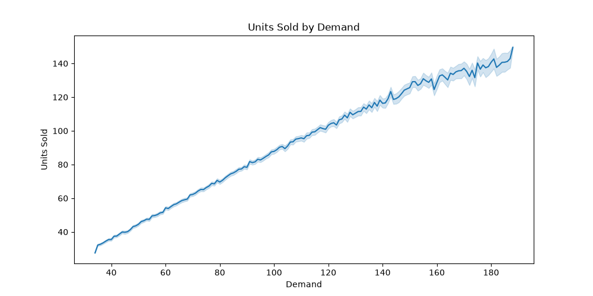
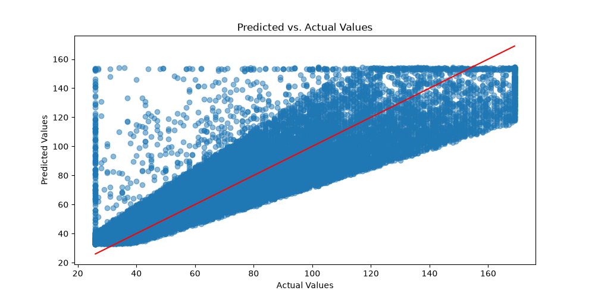
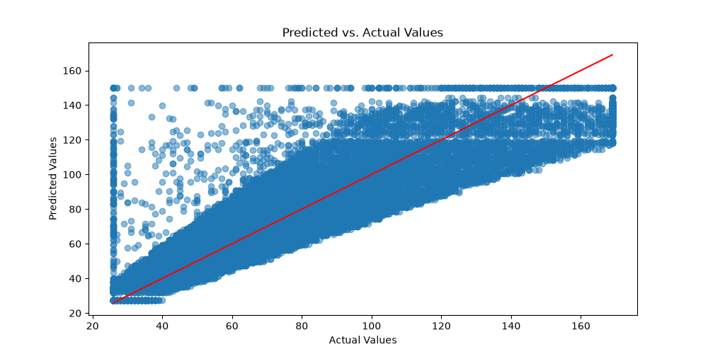

# Phoenix Jensen Capstone Project: Predicting Units Sold
This project is designed to predict the changes in the target variable of Units Sold to answer the question of how inventory should be adjusted to prevent back orders or out of stock items. 

## Problem Statement 
Back orders and out of stock items are a frequent issue for various companies. When items are out of stock and unavailable to consumers it creates inconveniences for both the customer and organization selling the product. This issue can add additional wait time for a consumer or create additional work for employees who have to interact with the order. 

This project aims to resolve, or lessen, the issue of backorders by predicting how units sold will change and using this understanding to more effectively manage inventory levels. This is relevant to individuals responsible for monitoring inventory, employees filling and invoicing orders, and stakeholders who are invested in the efficiency and success of an organization. 

## Data 
The data used for this project was collected from Kaggle. The dataset included 76,000 rows of data. The main transformation that this dataset went through was in relation to outliers. There was a significant number of outliers in the key features of demand, inventory levels, units sold, and units ordered. A cap was placed on the 5th and 95th percentile to avoid completely removing a large portion of the dataset. Additionally, this allowed for the extreme highs and lows of the dataset to be represented without skewing the final results.  

## Methodology 
Multiple approaches were tested throughout the duration of this project. Initially, a linear regression model was used since the data was organized in a time series and timing mattered for the future predictions of units sold. The various linear regression models that were created experienced moderate success. The model using the features of demand, price, discounts and promotions showed the most favorable evaluation metrics. The linear regression model performed well; however, a random forest model was also tested to account for non-linear relationships. The evaluation metrics shows that the random forest model had more favorable results than any of the previously created linear regression models.

The various different models were tested using different key features. Primarily, the models used the key feature of demand to predict the changes in units sold due to the strong positive relationship between the two variables. This relationship is observed in a high correlation of 0.84 seen in the correlation heatmap and the following chart depicting the relationship. 

As different models were tested different key features such as price, discounts, and promotions were considered. However, the final model showed the most favorable results when only using demand.

## Results 
The best performing linear regression model has a root mean squared error (RMSE) of 20.504 meaning that when the model is off, it is typically off by roughly 20 units sold. Considering that the average in stock level is around 300 units, this is an acceptable amount of error. Additionally, the model has an r squared value of 0.706 meaning 70.6% of the variance in units sold is explained by the chosen values of demand, price, discounts, and promotions. The performance of this linear regression model can be observed in this chart showing the actual values in relation to the values predicted by the model. 

The random forest model performed slightly better than the linear regression version with an RMSE of 20.288 and an R squared of 0.713. These metrics mean that the model is typically off by about 20 units sold and that 71.3% of the change in units sold is explained by the selected variables. Considering the size of this dataset, these are notable improvements. The performance of the random forest model can be viewed in this chart showing the actual values in relation to the values predicted by the model.
  

These results are essential to resolving the original business problem of how to reduce backorders. The model predicts the change in units sold with a typical error of about 20 units sold. Since the average inventory level is about 300 units, this is an acceptable amount of error in this context. This means the organization can reasonably use these predictions to understand the change in units sold that it will experience. The organization can utilize these predictions when managing inventory levels. This allows the organization to plan ahead and increase, decrease, or maintain certain inventory levels to accommodate for upcoming fluctuations.  

## Limitations
A limitation of this project is that it does not address seasonality or certain times of year. With more time, it would be valuable to explore how different seasons or busy times can impact the changes in units sold. This is a weakness of the project since demand and the frequency in which consumers are purchasing products can vary significantly during certain times, an example being the holiday season. 